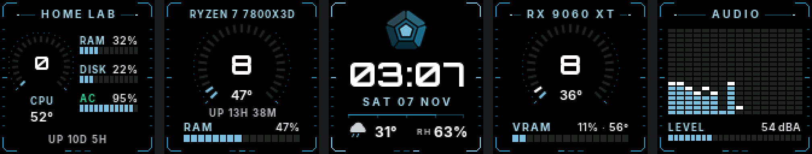

<p align="center">
  <picture>
    <source media="(prefers-color-scheme: dark)" srcset="design/pentadeck-lockup-dark.svg">
    
  </picture>
</p>

<p align="center"><b>Open cockpit firmware for the Divoom Times Gate.</b></p>



Pentadeck replaces the firmware of a [Divoom Times Gate](https://divoom.com/) (an ESP32‑S3 with
five 128×128 screens, LED strips, a buzzer and a microphone) with a spaceship‑cockpit dashboard
for your computers:

| Screen | Shows |
|---|---|
| **Home lab** | CPU load and temperature, RAM, disk, battery |
| **CPU** | load dial, temperature, RAM, uptime, with the CPU's name as the title |
| **Clock** | time, date, outside temperature and humidity (Open‑Meteo), the logo |
| **GPU** | load dial, temperatures, VRAM, with the GPU's name as the title |
| **Audio** | an 18‑band equaliser or a needle VU meter, and the room's loudness in dBA, from the built‑in mic |

The order is a setting, and any screen can be turned off.

- **Everything runs on the device.** It pulls a small JSON file from a stats agent on each machine
  you want to watch, and draws the screens itself at up to 30 fps.
- **Load alerts:**
  - The CPU and GPU panels turn orange and blink at 60 % load, and turn red and blink faster at 80 %.
  - The buzzer sounds for high temperatures, a machine going offline, a service going down, or a
    UPS or laptop losing AC power.
  - The buzzer stays quiet during night hours.
- **The LED chain** (both side strips, the back and the buttons board): the left strip, the back
  light and the right strip each pick their own effect and colour:
  - CPU or GPU load as a meter, turning orange and red when busy or hot;
  - the home lab's health;
  - a music meter, or a pulse that brightens with the sound;
  - glow, breathe, wave, comet, sparkle, fire or rainbow;
  - off.
- **A Wi‑Fi microphone for your PC.** The stats agent can play the device's mic into a virtual
  audio cable, so Zoom, Discord or OBS can use it ([agent/README.md](agent/README.md#microphone)).
  The AUDIO screen turns into a red **MIC LIVE** while it's on, and a switch on the settings page
  turns the stream off.
- **Low power when nobody's at the desk.** After a quiet spell with no one around (no sound, no
  buttons, no keyboard or mouse on the PC), the screens dim, the LEDs go off and the device slows
  down. Any sound wakes it. Day or night doesn't matter.
- **Settings page.** A mobile‑first page served by the device on your LAN covers:
  - the layout, brightness and night dimming;
  - the LEDs and alerts;
  - the stats agents and the location;
  - firmware updates.
- **Five buttons, Casio‑style modes.** MODE steps through them; a long MODE returns to the dashboard:
  - **Tuner:** a chromatic tuner from the microphone, from a bass's low E (41 Hz) to the top of a flute
    (2.3 kHz). The cents show across three screens, and the LED strips turn green when the note is in tune.
  - **Long tones:** practice for wind players. A ten‑second trace of the pitch (in cents) and the
    loudness runs across all five screens. It shows the held note's average and spread, and how long
    you held it, with your best.
  - **Tempo:** listens to the music and finds its BPM, then flashes the beat on the LEDs. You can also
    tap the tempo (a tapped tempo stays held), hold what it heard, or switch octave (1×, 2×, ½×).
    The metronome starts from the tempo held or found here.
  - **Chords:** names the chord being played (with its degree in the key: I, IV, V, vi …), finds
    the song's key and shows it the way a dizi is marked, "1 = Bb": the major scale that shares the
    song's notes (for a minor song, its relative major), so it names the dizi to pick. A second screen
    lists that dizi's notes from all holes closed (5 6 7 1 2 3 4) and lights the one you're playing.
  - **Metronome:** 30–240 BPM, with a pendulum, beat lights and a click on the buzzer.
  - **Stopwatch** with laps, and a **timer** that drains the LED strips and plays a melody at zero.
  - **Alarm:** a daily alarm (with LIGHT to snooze) and an hourly chime, set Casio‑style on the device.
  - **World clock:** home and two places of your choice, in the order you set (home in the middle
    by default), and UTC. A 24‑hour planner shows who is at work or awake when, in the same order,
    and left/right shift every clock to plan a call.
  - **Sound level:** dBA or dBZ, with max, min, Leq and a 16‑band spectrum across three screens.
  - **Stars:** a starfield through all five screens that speeds up with the music.
  - **Settings:** brightness, LEDs, volume, alerts, key beep, 12/24 h, the AUDIO screen's view, edited on the device.

  The buttons work the same way in every mode:
  - **LIGHT** gives full brightness for 10 s; a long press turns the LEDs off or on.
  - **Power** starts and stops; a long press puts the device to sleep.
  - **Left and right** change values.

  Every screen shows what its button does.
- **Sounds:** the alerts each have their own short sound, with pitch glides: a klaxon for heat, a
  power‑down and power‑up for links lost and restored, a red‑alert siren for mains power. You can
  preview them from the settings page.
- **Updates over Wi‑Fi** after the first install. The original firmware stays in the other app slot
  until the first Wi‑Fi update.

> Pentadeck is an independent project. It is not affiliated with or endorsed by Divoom. Flashing
> custom firmware may void your warranty. Back up your device's flash first (see
> [docs/FLASHING.md](docs/FLASHING.md)), and you can always go back.

## Repository

| Folder | What's in it |
|---|---|
| [`firmware/`](firmware/) | the ESP‑IDF 5.5 project (C) |
| [`webui/`](webui/) | the settings page (Vite + React + Tailwind), built into one gzipped file that the firmware embeds |
| [`agent/`](agent/) | the stats agent for Windows and Linux (Python, standard library only) |
| [`design/`](design/) | the logo: its geometry, generator and exports |
| [`docs/`](docs/) | the hardware map, flashing, and the HTTP API |
| [`assets/fonts/`](assets/fonts/) | Inter and Orbitron (SIL OFL 1.1), used to pre‑render the device's fonts |

## Quick start

1. **Build:** see [firmware/README.md](firmware/README.md). You need ESP‑IDF 5.5, and a
   `main/secrets.h` with your Wi‑Fi details and an access token.
2. **First install:** this is done over a serial adapter, once. See [docs/FLASHING.md](docs/FLASHING.md).
3. **Install a stats agent** on each machine to watch (see [agent/README.md](agent/README.md)).
   Windows: double‑click `agent/install-windows.cmd`, or in PowerShell:
   ```
   irm https://raw.githubusercontent.com/lesyhau/pentadeck/main/agent/install-windows.ps1 | iex
   ```
   Linux:
   ```
   curl -fsSL https://raw.githubusercontent.com/lesyhau/pentadeck/main/agent/install-linux.sh | sudo bash
   ```
   Each prints the URL to use in the next step.
4. **Open the device's IP** in a browser. Enter the access token, then set the agents' URLs
   (`http://<machine>:8765/stats`), your time zone and your location.
5. **Later updates:** upload the firmware from the settings page, or run
   `python firmware/tools/push.py <ip> ota firmware/build/pentadeck.bin`.

## Design

The mark is a **pentagon seen from above**: concentric rings around a courtyard.
- Five wings make the outer ring, one per screen, lit from the upper left.
- Inside them sit a continuous ring and a small pentagonal courtyard.
- On the clock screen, a soft light travels round the wings, one lap every four seconds.

Everything is generated from [`design/mark.py`](design/mark.py) by `python design/build_logo.py`.

The palette is a teal ramp (`#164E63` → `#A8D5E6`) on true black, with orange `#FB923C` and red for
alerts. The fonts are Inter for text and Orbitron for numbers and titles.

## License

MIT (see [LICENSE](LICENSE)). The fonts in `assets/fonts/` are under the SIL Open Font License 1.1
(see the licence files beside them). "Divoom" and "Times Gate" are trademarks of their owner and
are used here only to say which device this firmware runs on.
